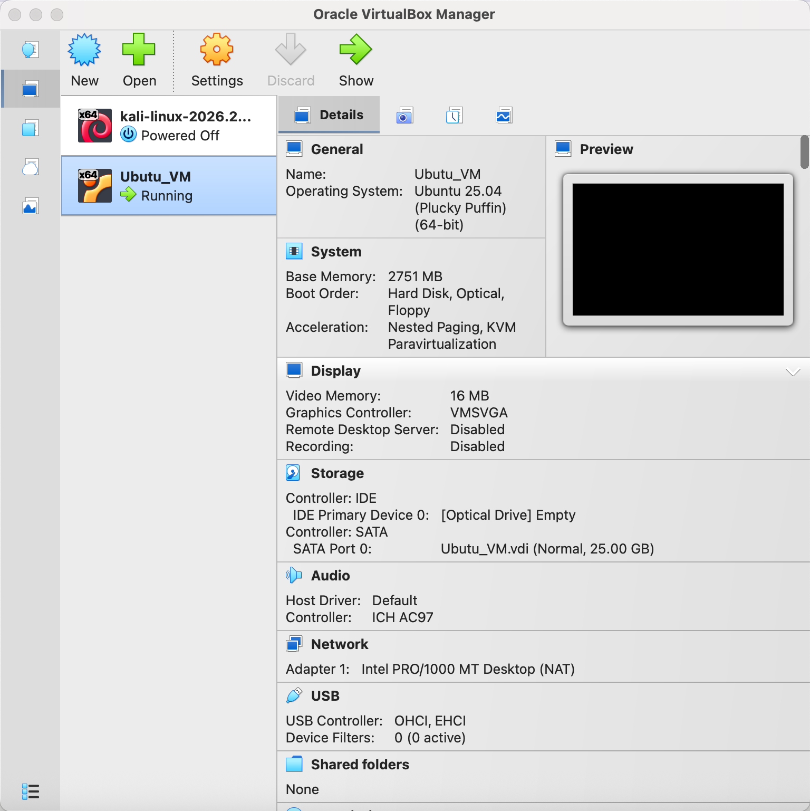
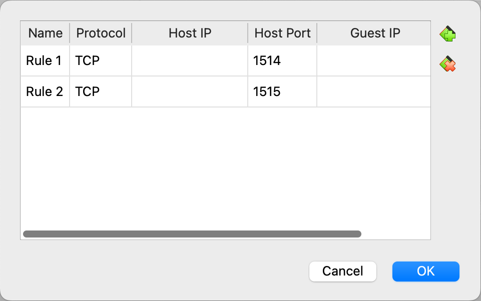
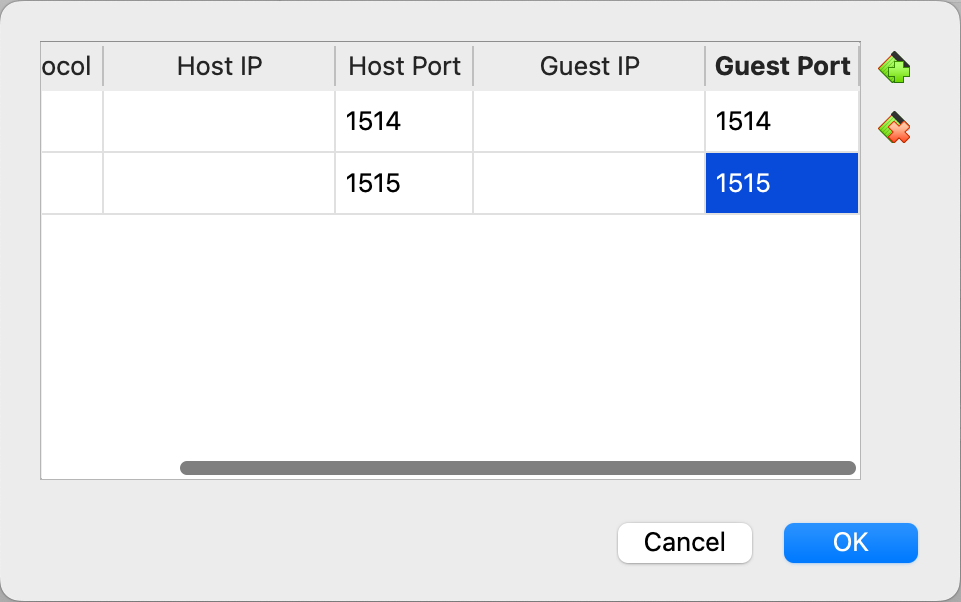
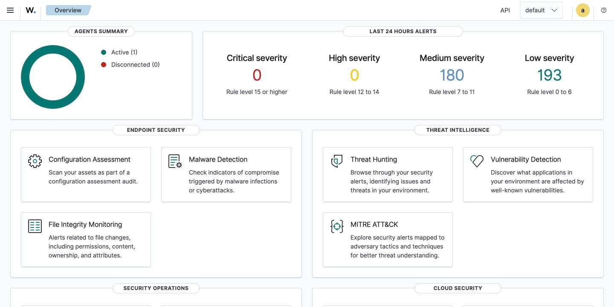
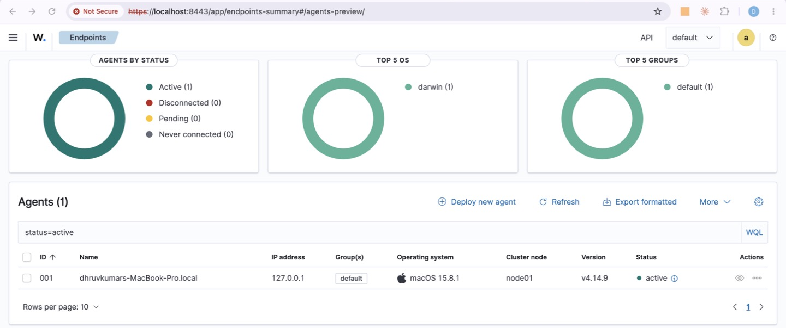
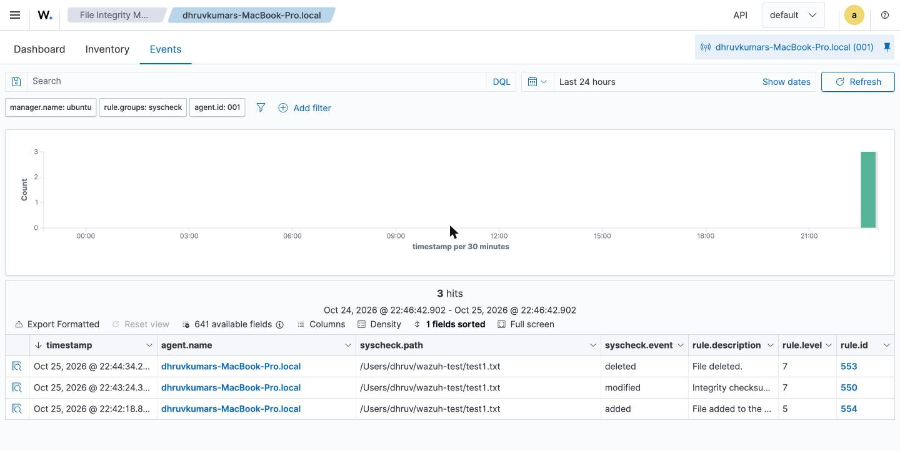
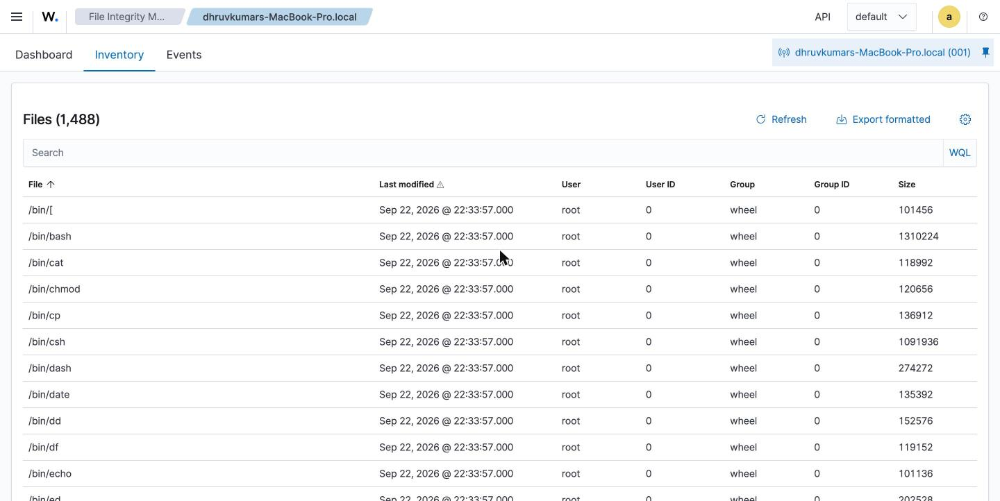
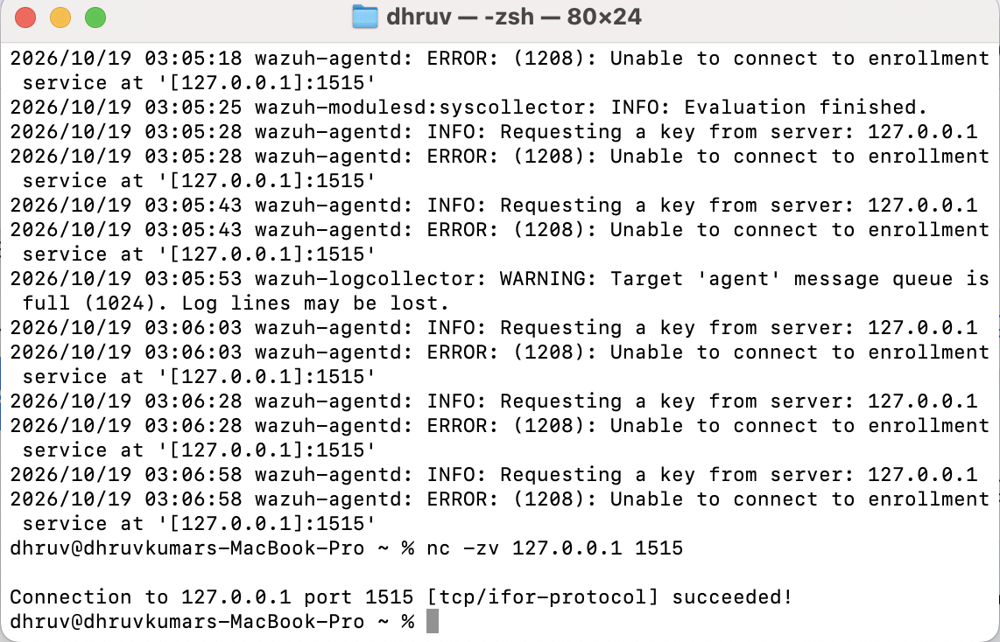

# Wazuh SIEM Home Lab on macOS — File Integrity Monitoring

A hands-on home lab where I built a **Wazuh SIEM** on an Ubuntu virtual machine and monitored my **MacBook** as an endpoint, with **File Integrity Monitoring (FIM)** alerting on file changes.

Built entirely on **macOS**: VirtualBox with **NAT + port forwarding**, the Wazuh manager on Ubuntu, and the Wazuh agent on the Mac.

   

---

## Table of Contents

1. [What I Built](#1-what-i-built)
2. [Lab Architecture](#2-lab-architecture)
3. [macOS Setup at a Glance](#3-macos-setup-at-a-glance)
4. [Prerequisites](#4-prerequisites)
5. [Step 1 — Create the Ubuntu VM in VirtualBox](#step-1--create-the-ubuntu-vm-in-virtualbox)
6. [Step 2 — Configure NAT Port Forwarding](#step-2--configure-nat-port-forwarding)
7. [Step 3 — Install the Wazuh Manager (Ubuntu)](#step-3--install-the-wazuh-manager-ubuntu)
8. [Step 4 — Access the Wazuh Dashboard](#step-4--access-the-wazuh-dashboard)
9. [Step 5 — Install the Wazuh Agent on macOS](#step-5--install-the-wazuh-agent-on-macos)
10. [Step 6 — Enroll the Agent With the Manager](#step-6--enroll-the-agent-with-the-manager)
11. [Step 7 — Configure File Integrity Monitoring on macOS](#step-7--configure-file-integrity-monitoring-on-macos)
12. [Step 8 — Verify & Generate Alerts](#step-8--verify--generate-alerts)
13. [Troubleshooting Log](#troubleshooting-log)
14. [Useful Commands](#useful-commands)
15. [What I Learned](#what-i-learned)
16. [Next Steps](#next-steps)

---

## 1. What I Built

| Capability | Result |
|---|---|
| SIEM | Wazuh all-in-one (manager + indexer + dashboard) on Ubuntu |
| Endpoint monitoring | macOS host enrolled as a Wazuh agent |
| File Integrity Monitoring | Alerts when files are **added, modified or deleted** in a watched folder |
| Networking | VirtualBox **NAT** with **port forwarding** (1514/1515) so the Mac reaches the VM through `127.0.0.1` |
| Troubleshooting | Fixed an agent enrollment failure (`ERROR 1208`), a broken VM saved state, and Mac↔VM clipboard issues (solved with SSH) |
| Verified result | Mac agent **active**; FIM caught file **added / modified / deleted** (rules 554 / 550 / 553) |

## 2. Lab Architecture

```
┌──────────────────────────── MacBook Pro (macOS host) ────────────────────────────┐
│                                                                                  │
│   Wazuh Agent (/Library/Ossec)                                                   │
│     • FIM watches /Users/<you>/wazuh-test                                        │
│     • Sends events to 127.0.0.1:1514, enrolls via 127.0.0.1:1515                 │
│                     │                                                            │
│                     ▼   VirtualBox NAT port forwarding                           │
│            host 1514 ──► guest 1514   (agent events)                             │
│            host 1515 ──► guest 1515   (agent enrollment)                         │
│                     │                                                            │
│   ┌─────────────────▼──────────── VirtualBox VM ────────────────────────────┐   │
│   │  Ubuntu (64-bit)                                                         │   │
│   │  Wazuh Manager + Wazuh Indexer + Wazuh Dashboard (https://localhost)     │   │
│   └──────────────────────────────────────────────────────────────────────────┘   │
└──────────────────────────────────────────────────────────────────────────────────┘
```

| Component | Host | Role |
|---|---|---|
| Wazuh Manager / Indexer / Dashboard | Ubuntu VM (VirtualBox) | Collects, analyses, stores and visualises agent data |
| Wazuh Agent | macOS (host machine) | Collects system events and file changes, sends them to the manager |

## 3. macOS Setup at a Glance

| Item | Value |
|---|---|
| Host | MacBook Pro, macOS 15.8.1 |
| Hypervisor | VirtualBox, **NAT + port forwarding** |
| Manager VM | Ubuntu 25.04, 8 GB RAM, 2 vCPUs |
| Agent installer | `.pkg` (Intel or Apple silicon build) |
| Agent path | `/Library/Ossec/` |
| Agent config | `/Library/Ossec/etc/ossec.conf` |
| Manager address used by agent | `127.0.0.1` (forwarded into the VM) |
| FIM mode | Scheduled scans every 60 s |

## 4. Prerequisites

- MacBook with **VirtualBox** installed
- **Ubuntu** 64-bit ISO (I used Ubuntu 25.04 Desktop; Ubuntu Server 22.04/24.04 LTS also works)
- At least **4 GB RAM**, **2 vCPUs** and **25–50 GB disk** for the VM (Wazuh's indexer is memory-hungry)
- Internet access inside the VM
- Admin (`sudo`) rights on the Mac
- Basic Linux / Terminal familiarity

---

## Step 1 — Create the Ubuntu VM in VirtualBox

1. Open VirtualBox → **New**.
2. Name it (e.g. `ubuntu_Lab`), select the Ubuntu ISO, type **Linux / Ubuntu (64-bit)**.
3. Give it memory, CPUs and a disk (see prerequisites).
4. Leave **Network → Adapter 1** as **NAT** (the default).
5. Start the VM and complete the Ubuntu installation.
6. Update the system:

```bash
sudo apt update && sudo apt upgrade -y
sudo apt install -y curl net-tools
```



## Step 2 — Configure NAT Port Forwarding

With NAT, the VM is hidden behind VirtualBox, so the Mac cannot reach it directly. Port forwarding opens the two ports the Wazuh agent needs.

1. Select the VM → **Settings → Network → Adapter 1 (NAT) → Advanced → Port Forwarding**.
2. Add these rules (leave Host IP and Guest IP blank):

| Name | Protocol | Host Port | Guest Port | Purpose |
|---|---|---|---|---|
| Rule 1 | TCP | 1514 | 1514 | Agent → manager event traffic |
| Rule 2 | TCP | 1515 | 1515 | Agent enrollment (key request) |
| Rule 3 | TCP | 2222 | 22 | SSH from the Mac's Terminal (see [Troubleshooting](#-copy-paste-doesnt-work-between-macos-and-the-ubuntu-vm)) |
| Rule 4 | TCP | 8443 | 443 | Open the dashboard from the Mac's browser at `https://localhost:8443` |





## Step 3 — Install the Wazuh Manager (Ubuntu)

Run these inside the Ubuntu VM.

**3.1 Add the Wazuh GPG key**

```bash
curl -s https://packages.wazuh.com/key/GPG-KEY-WAZUH | sudo gpg --dearmor -o /usr/share/keyrings/wazuh-archive-keyring.gpg
```

**3.2 Download and run the installation assistant**

```bash
curl -sO https://packages.wazuh.com/4.14/wazuh-install.sh && sudo bash ./wazuh-install.sh -a -i
```

- `-a` → all-in-one install (manager, indexer, dashboard)
- `-i` → ignore the minimum hardware check (useful on a small lab VM)

At the end, the script prints the **admin username and password**. Save them.

**3.3 Confirm the services are running**

```bash
sudo systemctl status wazuh-manager wazuh-indexer wazuh-dashboard
sudo ss -tlnp | grep -E '1514|1515|443'
```

## Step 4 — Access the Wazuh Dashboard

1. In the Ubuntu VM, open Firefox and go to `https://localhost`
   *(or — what I ended up using — from the Mac's Chrome at `https://localhost:8443` via Rule 4, so I could paste the admin password).*
2. Accept the self-signed certificate warning.
3. Log in with the `admin` credentials from the install output.



## Step 5 — Install the Wazuh Agent on macOS

Run these on the **Mac**, in Terminal.

> Use an agent version **equal to or older than** the manager version (my lab runs Wazuh **4.14**, agent **v4.14.9**).

**Intel Mac**

```bash
curl -so wazuh-agent.pkg https://packages.wazuh.com/4.x/macos/wazuh-agent-4.14.9-1.intel64.pkg
echo "WAZUH_MANAGER='127.0.0.1' && WAZUH_AGENT_NAME='MacBook-Agent'" > /tmp/wazuh_envs
sudo installer -pkg ./wazuh-agent.pkg -target /
```

**Apple silicon Mac (M1/M2/M3/M4)** — same steps, using the `arm64` package:

```bash
curl -so wazuh-agent.pkg https://packages.wazuh.com/4.x/macos/wazuh-agent-4.14.9-1.arm64.pkg
echo "WAZUH_MANAGER='127.0.0.1' && WAZUH_AGENT_NAME='MacBook-Agent'" > /tmp/wazuh_envs
sudo installer -pkg ./wazuh-agent.pkg -target /
```

Start the agent:

```bash
sudo launchctl bootstrap system /Library/LaunchDaemons/com.wazuh.agent.plist
```

macOS will show a **"Background Items Added – Wazuh Inc"** notification. That's expected: the agent runs as a background service. All agent files live in `/Library/Ossec/`.

## Step 6 — Enroll the Agent With the Manager

**Option A — Automatic enrollment (what I used).**
Because `WAZUH_MANAGER='127.0.0.1'` was set during install, the agent requests its key from the manager on port **1515** by itself. Check that it worked:

```bash
sudo tail -f /Library/Ossec/logs/ossec.log
```

You want to see `Valid key received` and then `Connected to the server`.

**Option B — Manual key.**

On the Ubuntu manager:

```bash
sudo /var/ossec/bin/manage_agents
# A → add agent (name: MacBook-Agent, IP: any)
# E → extract key for that agent → copy it
```

On the Mac:

```bash
sudo /Library/Ossec/bin/manage_agents -i <PASTE_KEY_HERE>
sudo /Library/Ossec/bin/wazuh-control restart
```

Make sure the manager address in `/Library/Ossec/etc/ossec.conf` is `127.0.0.1`:

```xml
<client>
  <server>
    <address>127.0.0.1</address>
    <port>1514</port>
    <protocol>tcp</protocol>
  </server>
</client>
```



*My MacBook (macOS 15.8.1, agent v4.14.9) enrolled through `127.0.0.1` and showing **active**.*

## Step 7 — Configure File Integrity Monitoring on macOS

1. Create a folder to monitor:

```bash
mkdir -p ~/wazuh-test
```

2. Edit the agent config:

```bash
sudo nano /Library/Ossec/etc/ossec.conf
```

3. Inside the `<syscheck>` block, lower the scan frequency for the lab and add the folder (full config in [`configs/ossec-syscheck-macos.xml`](configs/ossec-syscheck-macos.xml)):

```xml
<syscheck>
  <disabled>no</disabled>
  <!-- Default is 43200 s (12 h). 60 s is fine for a lab; raise it in production. -->
  <frequency>60</frequency>
  <scan_on_start>yes</scan_on_start>

  <directories check_all="yes" report_changes="yes">/Users/dhruv/wazuh-test</directories>
</syscheck>
```

> **macOS note:** FIM on macOS runs on scheduled scans. With `frequency` set to 60, alerts show up within about a minute.

4. Restart the agent:

```bash
sudo /Library/Ossec/bin/wazuh-control restart
```

## Step 8 — Verify & Generate Alerts

1. Dashboard → **Agents** → confirm the Mac agent (`dhruvkumars-MacBook-Pro.local`) is **Active**.
2. Generate file events on the Mac:

```bash
# wait 70 s between steps so each change lands in a separate 60 s scan
sleep 70; echo "hello wazuh" > ~/wazuh-test/test1.txt     # file added
sleep 70; echo "modified"   >> ~/wazuh-test/test1.txt     # file modified
sleep 70; rm ~/wazuh-test/test1.txt                        # file deleted
```

3. Open **File Integrity Monitoring → Events** in the dashboard (filter by the Mac agent).
4. Confirm the three alerts:

| Action | Wazuh rule ID | Description |
|---|---|---|
| File created | 554 | File added to the system |
| File modified | 550 | Integrity checksum changed |
| File deleted | 553 | File deleted |



*All three changes to `/Users/dhruv/wazuh-test/test1.txt` were caught: **added (554)**, **modified (550)**, **deleted (553)**.*

The **Inventory** tab also shows the baseline FIM built of the Mac (1,488 monitored files):



---

## Troubleshooting Log

### ❌ `ERROR: (1208): Unable to connect to enrollment service at '[127.0.0.1]:1515'`



**Symptom:** after installing the agent, `ossec.log` kept repeating `Requesting a key from server: 127.0.0.1` followed by error 1208. A side effect was `wazuh-logcollector: WARNING: Target 'agent' message queue is full`, because the agent couldn't send anything until it was enrolled.

**Root cause:** the agent points at `127.0.0.1`, which is the Mac itself. Without NAT port-forwarding rules, nothing on the Mac was listening on 1515, so the enrollment request never reached the Wazuh manager inside the VM.

**Fix:**

1. Added the port-forwarding rules **1514 → 1514** and **1515 → 1515** on the VM's NAT adapter ([Step 2](#step-2--configure-nat-port-forwarding)).
2. Made sure the VM was running and `wazuh-manager` was up.
3. Tested the path from the Mac:
   ```bash
   nc -zv 127.0.0.1 1515
   # Connection to 127.0.0.1 port 1515 [tcp/ifor-protocol] succeeded!
   ```
4. Restarted the agent; it received its key and connected.

### ❌ Copy-paste doesn't work between macOS and the Ubuntu VM

**Symptom:** couldn't paste commands or the dashboard password into the Ubuntu VM window, even after installing Guest Additions (`virtualbox-guest-utils`, `virtualbox-guest-x11`) and setting **Devices → Shared Clipboard → Bidirectional**.

**Root cause:** Ubuntu 25.04 runs a Wayland desktop session, and the VirtualBox shared clipboard is unreliable under Wayland.

**Fix — work from the Mac instead of the VM window:**

1. Installed SSH in Ubuntu:
   ```bash
   sudo apt install -y openssh-server && sudo systemctl enable --now ssh
   ```
2. Added NAT rule **2222 → 22**, then connected from the Mac's Terminal (⌘V works there):
   ```bash
   ssh -p 2222 vboxuser@127.0.0.1
   ```
3. Added NAT rule **8443 → 443** and opened the dashboard in the Mac's Chrome at `https://localhost:8443`.

This is also closer to how servers are managed in practice: remotely over SSH, not from a console.

### ❌ VM stuck on "Powering VM up" (state: Aborted-Saved)

**Fix:** cancelled the start, clicked **Discard** to drop the corrupted saved state (the disk is untouched), then started the VM fresh.

### Other checks if the agent still won't connect

| Check | Command |
|---|---|
| Manager listening in the VM | `sudo ss -tlnp \| grep -E '1514\|1515'` |
| Ubuntu firewall | `sudo ufw status` → `sudo ufw allow 1514/tcp && sudo ufw allow 1515/tcp` |
| Agent log on Mac | `sudo tail -n 50 /Library/Ossec/logs/ossec.log` |
| Manager log in VM | `sudo tail -n 50 /var/ossec/logs/ossec.log` |
| Version mismatch | Agent version must be ≤ manager version |

## Useful Commands

| Where | Purpose | Command |
|---|---|---|
| Mac | Agent status | `sudo /Library/Ossec/bin/wazuh-control status` |
| Mac | Restart agent | `sudo /Library/Ossec/bin/wazuh-control restart` |
| Mac | Live agent log | `sudo tail -f /Library/Ossec/logs/ossec.log` |
| Mac | Edit agent config | `sudo nano /Library/Ossec/etc/ossec.conf` |
| Ubuntu | List agents | `sudo /var/ossec/bin/agent_control -l` |
| Ubuntu | Manager status | `sudo systemctl status wazuh-manager` |
| Ubuntu | Live alerts | `sudo tail -f /var/ossec/logs/alerts/alerts.log` |

## What I Learned

- How a SIEM pipeline fits together: **agent → manager (analysis/rules) → indexer (storage) → dashboard**.
- How **VirtualBox NAT and port forwarding** work, and why an agent pointed at `127.0.0.1` can reach a VM.
- How to read agent logs, recognise error **1208**, and use `nc -zv` to prove where the network path breaks.
- macOS FIM runs as **scheduled** scans, so the scan `frequency` has to be tuned to see changes quickly.
- How FIM rule IDs (550/553/554) map to real file changes, which is the kind of alert a SOC analyst triages.

## Next Steps

- [ ] Map FIM alerts to **MITRE ATT&CK** (e.g. T1565 Data Manipulation, T1070.004 File Deletion)
- [ ] Add a **Linux agent** (Kali VM) and simulate SSH brute force to trigger authentication alerts
- [ ] Turn on **vulnerability detection** and review the Mac's findings
- [ ] Write a **custom rule** for changes to a "sensitive" file
- [ ] Set up email / Slack alerting for high-severity rules

---

**Author:** Dhruvkumar Prajapati — Cybersecurity & AI Analyst (SOC Operations), Hamilton, ON
[LinkedIn](https://linkedin.com/in/dhruvkumar-prajapati)
